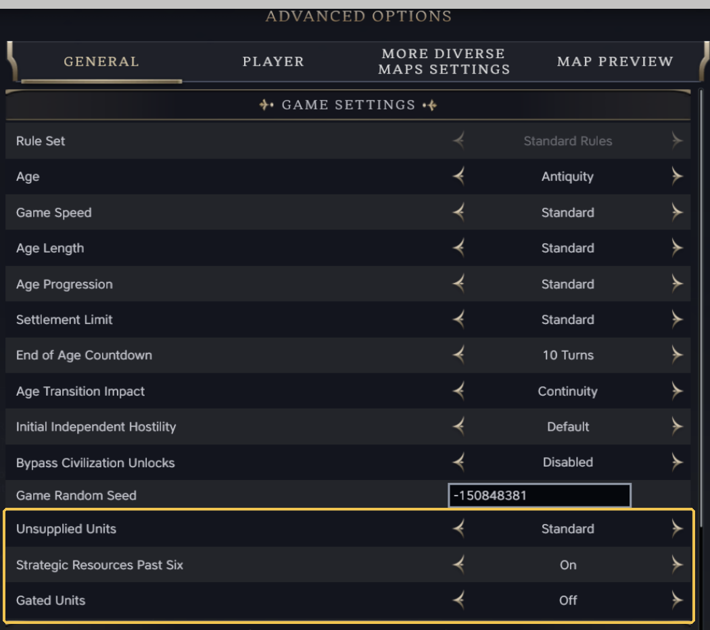
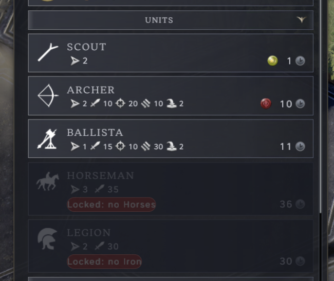

# Strategic Resources That Matter

A Civilization VII mod. Horses, Ivory, Iron, Niter, Hardwood, Oil, Coal and Rubber matter again. A unit that draws on one
of them fights weaker and trains slower while its owner has none of it, and each one you do hold still adds the
game's own bonus, so the count keeps mattering. Lose your last one, to a raid on the mine or a lost settlement, and the penalty
is back a turn later. Past six, where the game's own bonus stops, the count keeps adding strength.


*A Chariot with no Horses: 27 Combat Strength instead of 30, and the last cell in its stats says why.*

Single-player. In multiplayer, losing a resource does not bring the penalty back until that player gains a resource.

---

## What the player sees

Nothing is forbidden. Every unit can still be trained and upgraded as in the base game. What changes is the price of
going without:

- **None of the resource:** the unit has less Combat Strength (melee, and ranged and bombard where it has them),
  and a city puts less Production toward it, so it takes longer to train. With the default setting that is -3 Combat
  Strength and a third less Production, which makes the unit take half as long again.
- **One or more:** no penalty. The game's own +1 Combat Strength for each applies as before, up to six.
- **More than six:** +1 more Combat Strength at 8, 10, 12, 14, 16, 18 and 20, on the same units the
  game's own bonus covers.

The game tells you why, in your language:

- **Unit panel:** when you select a unit that is short of its resource, its stats gain one more cell, the resource's
  icon over the penalty in red; its tooltip says "Unsupplied: no Iron (-3 Combat Strength, slower to train)".
- **Combat preview:** the penalty is a line of its own beside the game's modifiers, for your unit and for the enemy's:
  "-3 Unsupplied: no Niter". Past six, the extra strength shows as one line beside the game's own, such as "+1
  Niter: 8 or more".
- **Production list:** a unit that needs a resource carries a pill on its item, beside the game's own text: "Needs
  Niter" on a red tint while you have none (the turn count shown is the slower one), "Niter: 2" once you have some.
  The item's hover tooltip carries the whole sentence under the unit's description: "Needs Niter. Without it: -3
  Combat Strength, slower to train." The pill follows a resource gained or lost while the list is open.
- **Resources:** a strategic resource's description, on the map and in the commerce screen, ends with the units it
  supplies for you in this age: "Supplies units: AT Gun, Assault Gun, Field Cannon and 3 more." A resource that doesn't
  supply any unit in this age keeps the game's own description.
- **Civilopedia:** a page under Game Concepts, Combat, "Strategic Resources", with the rules and the table
  below; and on each gated unit's page a line such as "Needs Iron: with none, -3 Combat Strength and slower to
  train", with the penalty your game was set up with.
- **Notification:** when you lose the last of a resource your units need, one notification at the start of the
  next turn: "Supply lost: no Niter. Your Field Cannon and 3 other units fight at -3 and train slower until you get
  Niter back." Once per loss; it ends with the turn, never holds the turn up, and a right-click dismisses it. Two
  losses in one turn share one notification.
- **The first time:** the first time you select one of your units while it is short of its resource, an advisor
  callout explains the rule in two sentences, and "Tell me more" opens the Civilopedia page. It shows once, not in
  every game, and only with tutorials or advisor warnings on in the game's options.

## Which units need what

A civilization's unique unit needs what the unit it replaces needs.

| Age | Units | Resource |
| --- | --- | --- |
| Antiquity | Cavalry: Chariot, Horseman and their unique versions | Horses |
| Antiquity | War elephants: the Khmer's Yuthahathi and the Maurya's Purabhettarah | Ivory |
| Antiquity | Infantry from the second tier: Spearman, Phalanx, Legion, Immortal and the others | Iron |
| Exploration | Cavalry: Courser, Knight, Lancer and their unique versions | Horses |
| Exploration | Infantry from the second tier: Man-At-Arms, Pikeman and their unique versions | Iron |
| Exploration | Siege from the third tier: Bombard and its unique version | Niter |
| Exploration | Heavy warships from the second tier: Carrack, Galleon and their unique versions | Hardwood or Pitch |
| Modern | Field artillery: Field Cannon, Field Gun and their unique versions | Niter |
| Modern | The heavier artillery: Mortar, Howitzer, AT Gun, Assault Gun and their unique versions | Oil |
| Modern | Armour: Landship, Tank and their unique versions | Oil |
| Modern | Battleships: Dreadnought, Battleship and their unique versions | Oil |
| Modern | Light warships: Ironclad, Cruiser, Destroyer, Barbary Corsair | Coal |
| Modern | The Cuirassier and the unique units that replace it (Cossack, Ghilman, Hussar at their first tier) | Horses |
| Modern | The Ship of the Line and the Turtle Ship | Hardwood or Pitch |
| Modern | The Submarine | Oil |
| Modern | Aircraft | Rubber |

A resource that reaches you over a trade route counts the same as one you mine yourself, from the turn the route lands.

Pitch works for the wooden warships as well as Hardwood, in Exploration and in Modern: one copy of either keeps them
at full strength and, under a locked value, lets you train them. Hardwood only grows on tundra and in the tropics,
while Pitch turns up in ordinary forest, so a temperate start still gets its Carracks and its Ships of the Line. The
game also never adds Hardwood at an age change, so a game that starts in Antiquity has it later only if the first map
drew some, while Pitch is placed when Exploration begins.

The war elephants count Ivory the way cavalry counts Horses: +1 Combat Strength per Ivory you hold, up to six, and
the steps past six with Strategic Resources Past Six on. The game's own +1 per Horses stops at them, so an elephant
scales with Ivory alone. Ivory is far commoner than Horses on the map, so the Khmer and Maurya are the best-supplied
cavalry in Antiquity; the balance numbers are in [docs/elephants-on-ivory.md](docs/elephants-on-ivory.md).
With Modern Supply Chains on (a setup option, off by default), every Modern unit needs a second resource as well:
see below.

Free of any requirement: the Warrior line and the Scout, ranged infantry (Archer, Crossbowman, Arquebusier), the
Catapult and the Trebuchet, the Cog, and Modern infantry, so every player can always defend.

## Losing a resource

The game notices a new resource the moment it arrives: a mine finishing on Iron lifts the penalty on your Spearmen
at once. It does not notice one going away. The mod makes it check every player again at the start of each turn, so
a resource lost by pillage, by a tile changing hands or by anything else brings the penalty back one turn later, for
you and for the AI players alike. A trade route ended by a war takes what it brought with it at once; an import that
dries up at the other end is gone from your count at once and the penalty follows one turn later. A player who still
has one keeps the bonus. The same check keeps the strength past six honest when the count falls, and raises the
notification above when your last one goes.

## Game setup options

Five options in game setup, beside the game's own options such as age length:

| Option | Values | Default |
| --- | --- | --- |
| Unsupplied Units | Off; Light (-2, 20% less Production); Standard (-3, 33% less); Harsh (-5, 50% less, twice as long to train); Locked: training; Locked: training and upgrade | Standard |
| Strategic Resources Past Six | Off; On (+1 at 8, 10, 12, 14, 16, 18 and 20 of a resource) | On |
| Modern Supply Chains | Off; On (every Modern unit needs a second resource) | Off |
| Free Tier-Up by Kills | Off; On (the Sengoku's Samurai move up a tier after three kills, Iron or not) | On |
| Strategic Resources on the Map | Base game; More (the ones this age's units need always on the map, half again to twice as many, at least two on each landmass players start on); Plenty (two to three times as many, at least three) | Base game |

Play Now uses the defaults. The options are fixed for the whole game once it starts. Before 1.2 the lock was its own
option, Gated Units; a save made with it keeps the gate it was started with.



*Advanced Options, Game Settings: the mod's options sit after the game's own.*

### Locked units

The two hardest values of Unsupplied Units lock units as well as penalising them. Units in the field take the Harsh
penalty, and a unit that needs a strategic resource cannot be trained or bought while you have none of it. It stays
in the production list, greyed out, with a "Locked: no Iron" pill after its stats, until you get some, and it is
locked again the moment your last one goes. Under "Locked: training and upgrade", no unit can be upgraded into it
either, and a commander's Upgrade All leaves it as it is, with the button greyed and the reason in its tooltip, as
long as every unit in the army is locked; with a mix, the button stays lit and the tooltip names the units that stay
as they are. Under "Locked: training", upgrades stay free, as in the base game. Units already in the field are never
locked: they keep fighting, at the Harsh penalty, and heal as usual. The units free of any requirement (the Warrior
line, the Scout, ranged infantry, the Catapult and Trebuchet, the Cog, Modern infantry) stay free, so every player
can always defend. So do the units an age change turns your army into: the Courser in Exploration, and the Field
Cannon, Cuirassier, Mortar and Ship of the Line in Modern, with any civilization's own version of them (the Turtle
Ship, the Janissary). You can always train them, and without the resource they fight at the Harsh penalty like any
other unit that needs one.
They also stay in the production list when the next unit in their line is gated. In the base game a unit goes out of
date as soon as the tech for its upgrade is in, so without Niter you'd lose the Trebuchet at Gunpowder and have no
siege unit at all. With Gated Units on, the Trebuchet stays trainable after Gunpowder until you have Niter, and the
same goes for the Warrior, the Swordsman, the Cog, the Cuirassier, the Frigate and the unique units in those lines.
Once you have the resource, the line works as in the base game: the old unit goes out of date and you can upgrade it.
Rome, Persia, Meiji Japan and Great Britain get their own Warrior or Frigate for this, the same unit under the same
name and with the same look, which upgrades straight into the Legion, the Immortal, the Mikasa or the Revenge, and
takes the same story rewards a Warrior or Frigate would.
Independent powers and city-states follow their own rule. A city-state can field a locked unit once its suzerain has
fielded one; an independent power, or a city-state with no suzerain, once you have. Until then, each one that turns up
is swapped at the start of your turn for the strongest unit of the same kind that needs no resource, at no higher
tier (a Landship becomes a Rifleman; a ship with no free counterpart is removed). A civilization's unique unit is
locked like the unit it replaces, and counts for it: a suzerain's Hoplite unlocks the Spearman. A unit a minor was
allowed to keep stays with it: if an independent power holds a Spearman because you'd fielded one, and it then becomes
a city-state under a suzerain who hasn't, it keeps that Spearman, and only the ones it raises after that wait.

The Sengoku's Samurai reach their second and third tier by themselves, after three kills at each tier, and the game
doesn't ask for Iron for that step, even under "Locked: training and upgrade". That's what you get with Free Tier-Up
by Kills on, the default. Turn it off under that value and kills don't move a Samurai up any more: it
upgrades like any other unit, which needs Iron: tier 2 once you have Heraldry, tier 3 once you have Metal Casting.
Off takes out the Samurai's kill counts, so it overrides another mod that changes them. Either way, a Sengoku player
with no Iron keeps the first-tier Samurai after the Kinsei civic, and the second tier takes over once Iron is held.
Without the Sengoku DLC the option doesn't change anything.



*Rome with no Horses and no Iron: the Horseman and the Legion stay listed, greyed out, and say why.*

The unit panel's cell tooltip ends with "New ones cannot be trained.", the resource description reads "Needed to train: ..."
instead of "Supplies units: ...", the lost-supply notification adds "New ones cannot be trained until then.", and a
second first-time callout, "Locked unit", explains the lock the first time you select a unit of a locked kind or a
city whose list shows one. The Civilopedia page gains a last chapter, "Locked units", and each gated unit's page a line
"Cannot be trained or bought without Iron."

### Modern Supply Chains

Off by default, because it makes for a hard game. On, every Modern unit that needs a resource needs a second one
too, so the supply lines of the industrial age matter as much as the first resource did:

| Units | Resources |
| --- | --- |
| Field artillery: Field Cannon, Field Gun and their unique versions | Niter and Coal |
| The heavier artillery: Mortar, Howitzer, AT Gun, Assault Gun and their unique versions | Oil and Coal |
| Armour: Landship, Tank and their unique versions | Oil and Coal |
| Battleships: Dreadnought, Battleship and their unique versions | Oil and Coal |
| Light warships: Ironclad, Cruiser, Destroyer, Barbary Corsair | Coal and Niter |
| The Cuirassier and its unique versions | Horses and Niter |
| The Ship of the Line and the Turtle Ship | Hardwood or Pitch, and Niter |
| The Submarine | Oil and Rubber |
| Aircraft | Rubber and Oil |

Iron isn't placed on Modern maps, so Coal stands for steel. Each missing resource costs the full Unsupplied Units
penalty, so a Tank with neither Oil nor Coal fights at twice it, and the unit panel shows one cell per missing
resource; the production pill reads "Needs Oil, Needs Coal". Under a locked value the unit needs both to be trained,
bought or (under "training and upgrade") upgraded into, and the pill reads "Locked: no Coal" for whichever is
missing. The lost-supply notification, the resource descriptions and the Civilopedia lines follow the second
resource too.

## AI players

The AI plays under the same rules. The penalty is ordinary unit and city data, so it reaches the AI the same way it
reaches you, and the turn-start check covers every major player. Independent powers and city-states aren't penalised.

The AI also goes after these resources. The mod gives the game's own AI a reason to: a city site with Iron, Horses,
Niter or another of the mod's resources rates higher, and so do growing onto a resource tile and importing one. In
90-turn test games on three maps, the computer players held 2 to 6 more kinds of these resources than without it,
fielded armies 23 to 36% stronger, and grew about as fast. A civilization whose own unique unit needs a resource it
doesn't have still builds that unit and takes the penalty, the way the base game's AI favours its unique units.

Under a locked value the AI is locked by the same data: an AI with no Iron can't train a Spearman, and its production
queue never sticks on a locked unit (it builds something else). Independent powers and city-states are held back as
described under "Locked units": the game exempts them from the lock, so the mod swaps their units instead.

## Compatibility

- Works with any mix of DLC. The unit tags only go on units that are in your game, so a unique unit from a DLC you
  don't own is skipped, and so is one a game update removes.
- Adds unit tags, modifiers, AI weights and five game setup options. Below the locked values, every base-game row and
  file stays as the game has it, apart from the map weights of the nine resources when Strategic Resources on the Map
  is at More or Plenty (multiplied, so another mod's change to them carries through). Under a locked value, the mod
  sets the game's own `StrategicResource` column on the gated units and the game's six resource-minimum parameters,
  and makes the units a free unit upgrades into (every Modern unit with Modern Supply Chains on) grant-only behind
  their resource.
- Another mod that sets that column or those parameters (a locally installed gameplay overhaul does, with minimums
  of 2 to 6) keeps the engine's rule by its own numbers, and this mod's lock texts step back to their plain form
  rather than promise an unlock at one that does not hold. Turn one of the two off to get a single rule.
- The unit panel cell comes from a wrapper around the panel's own refresh, so mods that change the unit panel keep
  working. The production line goes in the slot the game keeps for mods on each production item, and the resource
  line into the text the game's description component draws; neither replaces a screen or a tooltip. Tested with
  Readable Tooltips, QD Improved Plot Tooltip, Building Location Advisor, City Hall, Better Commerce Screen UI and Mod
  Commons.
- The notification is an ordinary game notification of the mod's own type, and the callout an item in the game's own
  tutorial manager, so mods that restyle the notification train or the tutorials show them as they show the game's
  (tested with Mav's UI Overhaul, Nasuellia Popups and Nasuellia Diplomacy Screens).
- Mods that rewrite the game's per-resource bonus leave the penalty alone; the curve past six follows the
  base game's unit classes (read from code, not tested).
- Ships the Tower Settings Keeper, which runs first and keeps every mod's settings readable after a restart. The mod
  itself stores one flag: whether the first-time callout has shown.

More detail, by kind of mod: [docs/compatibility.md](docs/compatibility.md).

## Saves

The setup options and the unit data are fixed when a game is created. A game started with the mod needs it to load.
If you add the mod while a game is under way, it takes effect from the next new game.

## Install

Subscribe on the Steam Workshop, or copy the `strategic-resources-that-matter` folder into
`~/Library/Application Support/Civilization VII/Mods/` (macOS) or `%LOCALAPPDATA%\Firaxis Games\Sid Meier's
Civilization VII\Mods\` (Windows), and enable it under Add-ons.

## Known limits

- Single-player only. The turn-start check is a local call, not a network request, so in a multiplayer game the mod
  switches it off and says so in the game's log. There, a lost resource brings its penalty back only once that player
  gains some resource.
- A loss shows one turn later, not at once.
- The first-time callout follows the game's options: with tutorials and advisor warnings both off it never shows.
  The game marks it seen in that save anyway, so turning warnings on later shows it in the next new game. In
  multiplayer neither the notification nor the callout shows.
- The curve stops at 20 of a resource.
- Under a locked value, a unit already in the production queue when the resource is lost keeps its progress and is
  completed: the game checks the resource when a unit is queued or bought, not when it finishes. Units it would
  have bought or queued after the loss are locked.
- The commander's Upgrade All is the game's own command, and its check doesn't read the resource: the mod greys the
  button and names the reason when every unit in the army is locked, and lists the locked ones when some can go.
  The engine refuses the locked units' upgrades either way; the AI's Upgrade All goes through the same engine check.
- The lock callout, like the unsupplied one, follows the game's tutorial options and shows once per profile.

## How it works

- `data/`: each unit that needs a resource gets one tag, `SR_SUPPLY_<NAME>` (a second one with Modern Supply Chains
  on, from `sr-modern-chains.sql`). Per age and setup value, every major player's units get the combat penalty and
  their cities the production cut, each cancelled by an equal bonus while the player has one. The curve is a set of
  +1 bonuses behind higher counts. The files are written by `scripts/build-data.mjs` from the rules in
  `scripts/gate-map.mjs`.
- `ui/sr-recheck.js`: at the start of every turn, gains and drops one off-map unit of a resource nothing else reads,
  for every major player. Gaining a resource is what makes the game re-check a player's requirements at the next
  turn roll.
- `ui/sr-supply-lost.js`: the notification, raised from the same turn start for the local player when a resource
  held at the last turn start is gone. The notification type and its icon are in `data/sr-notification*.xml`.
- `ui/sr-callout.js`: the first-time callout, an item in the game's tutorial manager at the advisor-warning level.
- `ui/sr-unit-panel.js`: the status cell on the unit panel.
- `ui/sr-production-line.js`: the line on a production item, in the game's `ProductionModInfo` slot.
- `ui/sr-army-upgrade.js`: the commander's Upgrade All under a locked value, read against each packed unit's own
  upgrade check.
- `ui/sr-resource-line.js`: the line in a strategic resource's description, added where the game's `Stylize`
  component draws that text.
- `ui/sr-registry.js`, `ui/sr-player-supply.js`, `ui/sr-supply.js`: the shared registry wrapper, engine reads and pure
  rules the lines, the notification and the callout use, so they never disagree.
- `ui/settings-keeper.js`: the Tower Settings Keeper, unchanged.

The evidence for each of these, run by run, is in [docs/verification-runs.md](docs/verification-runs.md).

## Development

Typed JavaScript checked by `tsc`, ESLint with size limits, and Node tests; no build step. See
[CONTRIBUTING.md](CONTRIBUTING.md).

```sh
npm install
npm run verify        # type check, lint, tests
npm run data          # rewrite data/ from the gate map
node scripts/deploy.mjs
```

## Civilopedia History Corrections

This mod also carries Civilopedia History Corrections, a text patch for
[Civilopedia Expanded: Independents](https://steamcommunity.com/sharedfiles/filedetails/?id=3815309882). With that mod
on, six East Asian history pages (Goguryeo, the Oirat, two Ryukyu pages, Nanzhao and Balhae) give each side where
historians in different countries disagree, and a few factual errors are fixed. With it off, the game's pages stay as
they are. The text is in `history-corrections/`, in English, Simplified Chinese and Traditional Chinese. Every Tower mod
that carries it writes the same text, so running several of them together is fine.

Those paragraphs were replaced because they didn't hold up. Some repeated Chinese state historiography as settled
fact, or recast a question most historians consider answered as still open. Some got basic dates and places wrong. And
the Oirat page called a genocide, the Qing destruction of most of the Dzungar people in 1755-1757, a "pacification."
I'm not leaving that in place. More corrections to Civilopedia Expanded may be added at any time, in any update.
Corrections may also be added for any other mod whose text I judge, in my sole discretion, to be bigoted,
genocide-denying or otherwise historically inaccurate. Running this mod alongside any of them means you accept those
replacements, including any added later. Switch this mod off and their pages read as their authors wrote them.

## License

Up to version 1.2.0 this mod was MIT, and copies of those versions stay MIT. Versions after 1.2.0 are under the Tower
Mod License 1.0 in [LICENSE](LICENSE), written in plain English.

You're welcome to play it, read the code to see how it works, and change your own copy for your own games. If you'd
like to reupload it, put parts of it in your own mod, or use it some other way, ask me first: open an issue here or
message Tower on Steam. `ui/settings-keeper.js` stays MIT so other mods can keep embedding it.

I don't want this mod's code, text or art used to train AI models, collected into AI training sets, or handed to AI
tools to copy into other projects, and the license doesn't allow it without my written permission. I also reserve the
rights to text and data mining of this work under Article 4(3) of the EU's Directive 2019/790.

Because the source is on GitHub, GitHub and its affiliates (Microsoft included) have their own license to it under
GitHub's Terms of Service, and since April 2026 that covers training their AI. Valve and Take-Two have the rights
their own terms give them. Sid Meier's Civilization VII and its assets belong to Firaxis Games and 2K. Material from
other people is listed in [LICENSE](LICENSE).
