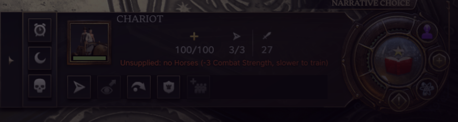

# Strategic Resources

A Civilization VII mod. Horses, Iron, Niter, Oil, Coal and Rubber matter again. A unit that draws on one of them
fights weaker and trains slower while its owner holds no copy of it, and every copy you do hold still adds the game's
own bonus, so the count keeps mattering. Lose your last copy, to a raid on the mine or a lost settlement, and the
penalty is back a turn later. Past six copies, where the game's own bonus stops, the count keeps adding strength.



*A Chariot with no Horses: 27 Combat Strength instead of 30, and the line under its stats says why.*

Single-player. In multiplayer, losing a resource does not bring the penalty back until that player gains a resource.

---

## What the player sees

Nothing is forbidden. Every unit can still be trained and upgraded as in the base game. What changes is the price of
going without:

- **No copy of the resource:** the unit has less Combat Strength (melee, and ranged and bombard where it has them),
  and a city puts less Production toward it, so it takes longer to train. With the default setting that is -3 Combat
  Strength and a third less Production, which makes the unit take half as long again.
- **One copy or more:** no penalty. The game's own +1 Combat Strength per copy applies as before, up to six copies.
- **More than six copies:** +1 more Combat Strength at 8, 10, 12, 14, 16, 18 and 20 copies, on the same units the
  game's per-copy bonus covers.

When you select a unit that is short of its resource, the unit panel says so under its stats, in your language:
"Unsupplied: no Iron (-3 Combat Strength, slower to train)".

## Which units need what

A civilization's unique unit needs what the unit it replaces needs.

| Age | Units | Resource |
| --- | --- | --- |
| Antiquity | Cavalry: Chariot, Horseman and their unique versions | Horses |
| Antiquity | Infantry from the second tier: Spearman, Phalanx, Legion, Immortal and the others | Iron |
| Exploration | Cavalry: Courser, Knight, Lancer and their unique versions | Horses |
| Exploration | Infantry from the second tier: Man-at-Arms, Pikeman and their unique versions | Iron |
| Exploration | Siege: Catapult, Trebuchet, Bombard, Hwacha | Niter |
| Exploration | Ships of the line: Carrack, Galleon and their unique versions | Niter |
| Modern | Artillery: Field Cannon, Field Gun, AT Gun, Mortar, Heavy Artillery, Assault Gun | Niter |
| Modern | Armour: Landship, Tank and their unique versions | Oil |
| Modern | Battleships: Dreadnought, Battleship and their unique versions | Oil |
| Modern | Light warships: Ironclad, Cruiser, Destroyer, Barbary Corsair | Coal |
| Modern | Aircraft | Rubber |

A copy that reaches you over a trade route counts the same as one you mine yourself, from the turn the route lands.

Free of any requirement: the Warrior line and the Scout, ranged infantry (Archer, Crossbowman, Arquebusier), the Cog
and the Frigate, the Cuirassier, the Submarine, and Modern infantry, so every player can always defend.

## Losing a resource

The game notices a new resource the moment it arrives: a mine finishing on Iron lifts the penalty on your Spearmen
at once. It does not notice one going away. The mod makes it check every player again at the start of each turn, so
a resource lost by pillage, by a tile changing hands or by anything else brings the penalty back one turn later, for
you and for the AI players alike. A trade route ended by a war takes its copies with it at once; an import that
dries up at the other end is gone from your count at once and the penalty follows one turn later. A player who still
holds a copy keeps the bonus. The same check keeps the strength
past six copies honest when the count falls.

## Game setup options

Two options in game setup, beside the game's own options such as age length:

| Option | Values | Default |
| --- | --- | --- |
| Unsupplied Units | Off; Light (-2, 20% less Production); Standard (-3, 33% less); Harsh (-5, 50% less, twice as long to train) | Standard |
| Strategic Resources Past Six | Off; On (+1 at 8, 10, 12, 14, 16, 18 and 20 copies) | On |

Play Now uses the defaults. The options are fixed for the whole game once it starts.

## AI players

The AI plays under the same rules and needs no special handling: the penalty is ordinary unit and city data, and the
turn-start check covers every major player. Independent powers and city-states are not penalised. In testing, an AI
with no Iron kept building Warriors where, with Iron, it built Legions.

## Compatibility

- Adds unit tags, modifiers and two game setup options. Changes no base-game row and replaces no base-game file.
- The unit panel line comes from a wrapper around the panel's own refresh, so mods that change the unit panel or the
  plot and unit tooltips keep working. Readable Tooltips was tested alongside.
- Mods that rewrite the game's per-copy resource bonus leave the penalty alone; the curve past six copies follows the
  base game's unit classes (read from code, not tested).
- Ships the Tower Settings Keeper, which runs first and keeps every mod's settings readable after a restart. The mod
  itself stores no settings.

More detail, by kind of mod: [docs/compatibility.md](docs/compatibility.md).

## Saves

The setup options and the unit data are fixed when a game is created. A game started with the mod needs it to load;
adding the mod to a game already under way does nothing until a new game is started.

## Install

Subscribe on the Steam Workshop, or copy the `strategic-resources` folder into
`~/Library/Application Support/Civilization VII/Mods/` (macOS) or `%LOCALAPPDATA%\Firaxis Games\Sid Meier's
Civilization VII\Mods\` (Windows), and enable it under Add-ons.

## Known limits

- Single-player only. The turn-start check is a local call, not a network request, so in a multiplayer game the mod
  switches it off and says so in the game's log. There, a lost resource brings its penalty back only once that player
  gains some resource.
- A loss shows one turn later, not at once.
- The curve stops at 20 copies.

## How it works

- `data/`: each unit that needs a resource gets one tag, `SR_SUPPLY_<NAME>`. Per age and setup value, every major
  player's units get the combat penalty and their cities the production cut, each cancelled by an equal bonus while
  the player holds a copy. The curve is a set of +1 bonuses behind higher copy counts. The files are written by
  `scripts/build-data.mjs` from the rules in `scripts/gate-map.mjs`.
- `ui/sr-recheck.js`: at the start of every turn, gains and drops one off-map copy of a resource nothing else reads,
  for every major player. Gaining a resource is what makes the game re-check a player's requirements at the next
  turn roll.
- `ui/sr-unit-panel.js`: the line on the unit panel.
- `ui/settings-keeper.js`: the Tower Settings Keeper, unchanged.

The evidence for each of these, run by run, is in [docs/verification-runs.md](docs/verification-runs.md).

## Development

Typed JavaScript checked by `tsc`, ESLint with size limits, and Node tests; no build step. See
[CONTRIBUTING.md](CONTRIBUTING.md).

```sh
npm install
npm run verify        # type check, lint, tests
npm run data          # rewrite data/ from the gate map
node scripts/deploy.mjs
```

## License

MIT. See [LICENSE](LICENSE).
